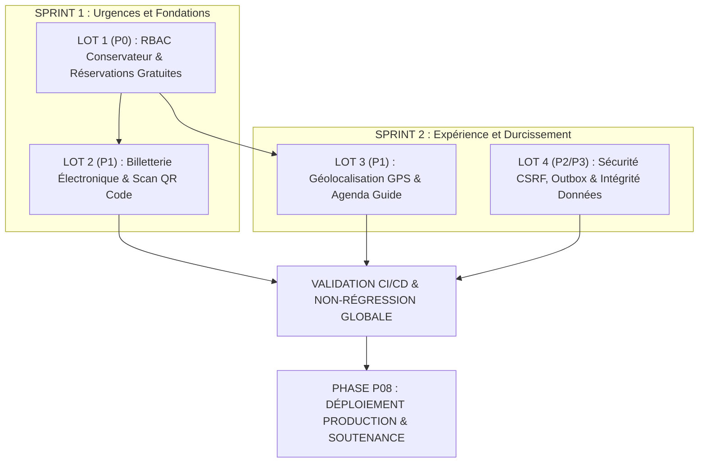

# PLAN DE REMÉDIATION ET DE MISE EN CONFORMITÉ — MISSION P07.5
**Plateforme de Valorisation du Patrimoine Touristique de la Casamance**  
*Université Assane Seck de Ziguinchor — Licence 3 Ingénierie Informatique*  
**Date d'audit** : 18 Novembre 2026  
**Branche d'audit** : `feature/p07-5-functional-audit`  

---

## 1. INTRODUCTION ET OBJECTIFS DU PLAN

L'audit approfondi réalisé lors de la mission P07.5 a démontré la solidité de l'architecture microservices (Java 21, Spring Boot, Spring Cloud Gateway, 7 bases PostgreSQL 16 étanches, Angular 22).
Cependant, l'existence de **2 anomalies bloquantes critiques (P0)** et l'absence de **5 fonctionnalités majeures (P1)** rendent indispensable une phase intermédiaire de mise en conformité avant d'envisager la mise en production finale et la soutenance (Phase P08).

Ce document définit la stratégie opérationnelle de remédiation : découpage par lots, ordonnancement des dépendances, gouvernance Git, calendrier prévisionnel et critères formels d'acceptation.

---

## 2. SYNTHÈSE DE LA CLASSIFICATION ET PRIORISATION DES ANOMALIES

```
                        ┌────────────────────────────────────────────────────────┐
                        │             15 ANOMALIES IDENTIFIÉES                   │
                        └──────────────────────────┬─────────────────────────────┘
                                                   │
                ┌───────────────────┬──────────────┴───────┬───────────────────┐
                ▼                   ▼                      ▼                   ▼
        ┌───────────────┐   ┌───────────────┐      ┌───────────────┐   ┌───────────────┐
        │  P0: BLOQUANT │   │  P1: MAJEUR   │      │  P2: MOYEN    │   │  P3: MINEUR   │
        │  (2 anomalies)│   │ (5 anomalies) │      │ (6 anomalies) │   │ (2 anomalies) │
        └───────────────┘   └───────────────┘      └───────────────┘   └───────────────┘
```

| Priorité | Libellé de sévérité | Délai de résolution | Impact sur le passage en P08 |
| :---: | :--- | :--- | :--- |
| **P0** | **Bloquante** | Immédiat (Sprint 1) | **Bloquant absolu** : Aucun passage en P08 sans résolution et validation formelle. |
| **P1** | **Majeure** | Court terme (Sprint 1 - Sprint 2) | **Bloquant fonctionnel** : Nécessaire pour couvrir les cas d'utilisation de la soutenance (billetterie, GPS, agenda). |
| **P2** | **Moyenne** | Moyen terme (Sprint 2) | Non bloquant pour la démonstration mais fortement recommandé pour la robustesse opérationnelle. |
| **P3** | **Mineure** | Fin de projet / Post-soutenance | Améliorations ergonomiques et cosmétiques sans risque sur l'intégrité du système. |

---

## 3. DÉCOUPAGE EN LOTS OPÉRATIONNELS ET DÉPENDANCES TECHNIQUES

Les corrections sont structurées en 4 lots cohérents conçus pour limiter les conflits de code et respecter les dépendances logiques entre microservices :



### 3.1. Lot 1 : Urgences Bloquantes P0 (Sprint 1 — Priorité Maximale)
- **Périmètre** :
  - `ANOM-P0-01` : Attribution des permissions `GUIDE:VALIDER` et `GUIDE:SUSPENDRE` au rôle `CONSERVATEUR` (migration Flyway `ms-utilisateur`, filtres `api-gateway`, visibilité `GuideService`).
  - `ANOM-P0-02` : Transition directe `BROUILLON -> CONFIRMEE` pour les réservations gratuites (montant 0 XOF) dans `ms-reservation` et contournement de la passerelle de paiement dans le front-end.
- **Microservices impactés** : `ms-utilisateur`, `api-gateway`, `ms-reservation`, `frontend-angular`.
- **Livrables attendus** : Déblocage immédiat des parcours `E2E-02` et `E2E-03`.

### 3.2. Lot 2 : Billetterie Électronique et Contrôle d'Accès P1 (Sprint 1)
- **Périmètre** :
  - `ANOM-P1-05` : Modèle de données `Billet`, génération de tokens QR Code HMAC sécurisés, endpoint atomique de scan `/api/visites/valider`, composant d'affichage touriste et écran de scan pour le gestionnaire de site.
- **Dépendance** : Nécessite que le Lot 1 soit terminé (les billets ne peuvent être générés que sur des réservations confirmées, y compris gratuites).
- **Livrables attendus** : Parcours `E2E-06` opérationnel.

### 3.3. Lot 3 : Géolocalisation Réelle, Agenda Guide & Avis P1 (Sprint 2)
- **Périmètre** :
  - `ANOM-P1-04` : Recherche à proximité via calcul Haversine dans `ms-patrimoine` et bouton "Autour de moi" (API Geolocation HTML5) dans le frontend (`E2E-09`).
  - `ANOM-P1-02` : Consultation de l'agenda personnel du guide par créneaux chronologiques (`GUIDE-03`).
  - `ANOM-P1-03` : Droit de réponse aux avis pour les guides touristiques (`GUIDE-05`).
  - `ANOM-P1-01` : Détection de chevauchement de créneaux lors de la planification de circuits (`CONS-06`).
- **Livrables attendus** : Couverture complète des exigences touristiques et des guides.

### 3.4. Lot 4 : Durcissement Sécurité, Outbox et Intégrité P2/P3 (Sprint 2)
- **Périmètre** :
  - `ANOM-P2-04` : Synchronisation du cycle de vie du cookie CSRF avec le refresh token de session.
  - `ANOM-P2-03` : Émission d'un événement d'outbox de remboursement lors de l'annulation d'une réservation confirmée.
  - `ANOM-P2-05` : Contrôle d'unicité préventif sur l'e-mail dans l'administration des utilisateurs (409 au lieu de 500).
  - `ANOM-P2-06` : Gestion du statut Dead-Letter Queue sur les échecs répétitifs de l'outbox `ms-paiement`.
  - `ANOM-P2-01` & `ANOM-P2-02` : Enrichissement de la galerie multimédia et structuration des horaires d'ouverture.
  - `ANOM-P3-01` & `ANOM-P3-02` : Assainissement d'URI et badge visuel d'affectation guide.

---

## 4. GOUVERNANCE GIT ET STRATÉGIE DE BRANCHEMENT

Pour garantir une traçabilité totale et prévenir toute dégradation de la branche principale :

1. **Branche source** : Chaque lot démarre depuis la dernière version consolidée de `develop`.
2. **Nomenclature des branches** :
   - Lot 1 : `fix/p07-6-lot1-p0-rbac-free-bookings`
   - Lot 2 : `feature/p07-6-lot2-electronic-tickets-qr`
   - Lot 3 : `feature/p07-6-lot3-gps-agenda-reviews`
   - Lot 4 : `fix/p07-6-lot4-security-and-outbox`
3. **Workflow de fusion** :
   - Exécution obligatoire de `./verify-integration.sh` en local avant tout push.
   - Validation de la CI GitHub Actions (100% verte sur les 9 modules backend et le frontend).
   - Revue de code humaine et fusion via Pull Request Squash & Merge dans `develop`.
   - **Interdiction formelle** de fusionner directement sans validation humaine.

---

## 5. CALENDRIER PRÉVISIONNEL DE MISE EN CONFORMITÉ

| Phase / Étape | Durée estimée | Objectif clé | Jalons de validation |
| :--- | :---: | :--- | :--- |
| **Phase P07.5** *(Actuelle)* | Terminé | Audit fonctionnel, cartographie des écarts, matrice de conformité et registre d'anomalies. | 6 livrables documentaires validés. |
| **P07.6 — Sprint 1 (Lot 1)** | 1 jour | Déblocage des 2 anomalies P0 (Conservateur & Réservations gratuites). | Tests P0 validés, PR Lot 1 fusionnée dans `develop`. |
| **P07.6 — Sprint 1 (Lot 2)** | 2 jours | Développement de la billetterie électronique et du scan QR Code (Lot 2). | Tests Billet / Scan validés, PR Lot 2 fusionnée. |
| **P07.6 — Sprint 2 (Lot 3)** | 2 jours | Géolocalisation GPS réelle, agenda guide et réponses aux avis (Lot 3). | Tests Haversine / Agenda validés, PR Lot 3 fusionnée. |
| **P07.6 — Sprint 2 (Lot 4)** | 1 jour | Durcissement CSRF, outbox de remboursement et intégrité utilisateurs (Lot 4). | Tests d'intégration complets validés, PR Lot 4 fusionnée. |
| **Recette Finale & Bilan** | 1 jour | Rejeu des 9 scénarios de bout en bout E2E-01 à E2E-09 sur environnement complet. | Taux de conformité 100%, rapport de recette finale validé. |
| **Phase P08** | Planifiée | Mise en production, packaging conteneurs, documentation d'exploitation et soutenance. | Déploiement officiel et soutenance de licence. |

---

## 6. CRITÈRES FORMELS D'ACCEPTATION ET MÉTRIQUES DE SORTIE

Le passage formel à la phase **P08** est subordonné au respect strict de l'ensemble des critères suivants :

1. **Zéro anomalie P0 / P1 résiduelle** : Les anomalies `ANOM-P0-01`, `ANOM-P0-02`, `ANOM-P1-01`, `ANOM-P1-02`, `ANOM-P1-03`, `ANOM-P1-04`, `ANOM-P1-05` doivent être clôturées avec preuves de tests à l'appui.
2. **Succès intégral de la suite de tests automatisés** :
   - 100% de succès sur les tests backend existants (minimum 195 tests passants) plus les nouveaux tests unitaires et d'intégration développés pour les lots 1 à 4.
   - 100% de succès sur la suite Vitest front-end (minimum 75 tests passants plus les tests de nouveaux composants).
   - Compilation TypeScript en mode strict et build de production Angular sans avertissement bloquant.
3. **Conformité des 9 parcours de bout en bout** :
   - Tous les parcours `E2E-01` à `E2E-09` doivent être exécutables avec succès sur la plateforme locale conteneurisée.
4. **Intégrité de l'architecture microservices** :
   - Maintien absolu de l'isolation des 7 bases PostgreSQL 16 (zéro clé étrangère inter-bases, zéro requête croisée).
   - Étanchéité totale des routes internes `/api/*/internal/**` vérifiée depuis la passerelle.
   - Idempotence garantie sur les paiements simulés et les réservations concurrentes.
