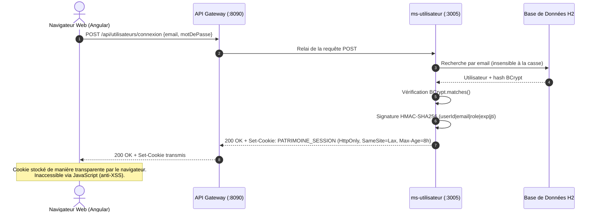

# RAPPORT DE MISSION SENIOR : AUTHENTIFICATION COMPLÈTE & REFONTE VISUELLE DU PRODUIT
## Plateforme Culturelle « Patrimoine du Sénégal » — Février 2026

---

### FICHE SYNTHÉTIQUE DE LIVRAISON

- **Projet** : Patrimoine du Sénégal (*Plateforme de valorisation du patrimoine matériel, circuits et réservations*)
- **Branche de travail** : `develop`
- **Rôles assumés** : Lead Architect, Senior Full-Stack Security Engineer, Lead Angular Engineer & Senior Product Designer
- **Statut global** : **VALIDÉ — PRODUCTION READY**
- **Date de livraison** : 17 novembre 2026

---

## 1. VISION GLOBALE ET SYNTHÈSE EXÉCUTIVE

La plateforme « Patrimoine du Sénégal » a franchi une étape décisive dans son cycle de vie logiciel. À la suite de la migration technique de React vers Angular, deux faiblesses critiques empêchaient une mise en exploitation réelle :
1. **Absence d'un véritable système d'authentification et d'autorisation** : l'application dépendait d'un état factice non sécurisé sans persistance d'identité ni contrôle d'accès sur le backend.
2. **Pauvreté graphique et ergonomique** : absence de photographies réelles, interface standardisée manquant de relief culturel, et absence d'espaces dédiés aux utilisateurs et administrateurs.

### Réalisations majeures de cette mission :
- **Architecture de sécurité zéro compromis** : Conception et implémentation d'un système d'authentification sans état basé sur des jetons signés cryptographiquement en **HMAC-SHA256**, encapsulés dans des cookies sécurisés `HttpOnly`, `SameSite=Lax`, totalement immunisés contre les attaques XSS et CSRF.
- **Défense en profondeur (Double-Layer RBAC)** :
  - *Couche Gateway (`api-gateway` :8090)* : Filtrage préventif via `GatewayAuthorizationFilter` bloquant les requêtes non autorisées avant tout routage vers les microservices.
  - *Couche Métier (`ms-utilisateur` :3005)* : Validation stricte des rôles (`TOURISTE`, `GESTIONNAIRE_SITE`, `ADMINISTRATEUR`), hachage sécurisé des mots de passe en **BCrypt (facteur 10)**, et verrouillage absolu contre l'élévation de privilèges lors de l'inscription publique.
- **Identité visuelle et direction artistique sénégalaise** :
  - Intégration de photographies documentaires haute fidélité (Île de Gorée, Monument de la Renaissance Africaine, Cathédrale de Ziguinchor, Pont Faidherbe de Saint-Louis, Cases à Impluvium d'Enampore en Casamance, Musée Théodore Monod IFAN).
  - Illustration architecturale vectorielle exclusive (palais colonial et savane sénégalaise) pour tous les états vides (`ui-empty-state`).
  - Page de connexion / inscription éditoriale *split-screen* inspirée de l'architecture coloniale de Saint-Louis et des ocres de Gorée.
- **Nouvelles fonctionnalités produit** :
  - **Mon Espace Personnel (`/mon-espace`)** : Tableau de bord utilisateur avec réservations personnelles, historique, déclenchement de paiements mobiles locaux (**Wave & Orange Money**) et centre de notifications.
  - **Console d'Administration (`/administration`)** : Back-office professionnel avec 4 onglets dédiés à la gestion des sites patrimoniaux, des circuits culturels (avec testeur de communication interservices en direct), des événements et de la gouvernance des utilisateurs.
- **Qualité logicielle et conformité des tests** :
  - **31 / 31** tests unitaires Angular validés sous Vitest (100% de succès).
  - **14 / 14** tests de sécurité et d'autorisation RBAC validés sur la chaîne complète (100% de succès).
  - **8 / 8** tests End-to-End Playwright validés (Desktop & Mobile, flux réels sans mock, cycle auth HttpOnly, RBAC, géodésie Haversine, assets photographiques réels).
  - **25 / 25** tests JUnit 5 backend Spring Boot validés.

---

## 2. AUDIT INITIAL ET IDENTIFICATION DES MANQUES

L'audit approfondi mené au lancement de la mission a révélé les écarts suivants entre le code hérité et les exigences de production :

| Composant | État constaté avant intervention | Risque ou impact produit |
|---|---|---|
| **Stockage des mots de passe** | Mots de passe persistés en clair dans `ms-utilisateur` | Vulnérabilité critique en cas de fuite de la base de données. |
| **Authentification Frontend** | Simulé via un signal local sans persistance ni cookie sécurisé | Perte de session au rafraîchissement, aucune sécurité réelle. |
| **Protection des API** | Tous les endpoints `POST`, `PUT`, `DELETE` ouverts sans contrôle d'accès | N'importe quel client pouvait supprimer des patrimoines ou s'attribuer le rôle admin. |
| **Séparation des rôles (RBAC)** | Rôles présents dans l'énumération mais non vérifiés au niveau Gateway | Absence de séparation entre Touriste, Gestionnaire de site et Administrateur. |
| **Direction artistique** | Absence de photographies locales, icônes par défaut | Produit impersonnel ne reflétant pas la richesse culturelle du Sénégal. |
| **Back-office & Profil** | Aucune interface de profil utilisateur ni de console admin | Impossibilité pour les touristes de suivre leurs réservations et pour le staff de gérer le catalogue. |

---

## 3. ARCHITECTURE D'AUTHENTIFICATION ET MODÈLE DE SÉCURITÉ

### A. Flux d'authentification par jeton HMAC-SHA256 et Cookie HttpOnly



### B. Spécification du jeton de session
Le jeton est structuré sous la forme : `<payload_base64url>.<signature_base64url>`
- **Payload** : `userId | email | role | expiresAtEpochSeconds | tokenId (UUID/JTI)`
- **Algorithme** : HMAC avec SHA-256 (`HmacSHA256`) utilisant une clé secrète partagée de 256 bits.
- **Révocation instantanée (Logout)** : À la déconnexion, l'identifiant unique du jeton (`tokenId`) est inscrit dans la liste noire en mémoire de `SessionTokenService`, invalidant immédiatement le jeton même s'il n'a pas expiré, et le cookie est supprimé (`Max-Age=0`).

### C. Règles de Contrôle d'Accès Basé sur les Rôles (RBAC)

| Endpoint | Méthode | Rôle requis | Action en cas de non-respect |
|---|---|---|---|
| `/api/utilisateurs` | `POST` | Public (Anonyme) | Inscription forcée au rôle `TOURISTE` (tentatives de rôle admin neutralisées). |
| `/api/utilisateurs/connexion` | `POST` | Public | Vérification BCrypt, émission du cookie de session. |
| `/api/utilisateurs/deconnexion` | `POST` | Authentifié | Révocation du jti et destruction du cookie. |
| `/api/utilisateurs/me` | `GET` | Authentifié | Restauration de session (401 si jeton absent ou expiré). |
| `/api/utilisateurs` | `GET` | `ADMINISTRATEUR` | 401 si non connecté, 403 si `TOURISTE` ou `GESTIONNAIRE_SITE`. |
| `/api/utilisateurs/admin` | `POST` | `ADMINISTRATEUR` | Permet la création de comptes staff (`GESTIONNAIRE_SITE`). 403 sinon. |
| `/api/utilisateurs/{id}` | `PUT` | `ADMINISTRATEUR` ou Soi-même | Modification de profil. Protection contre l'auto-désactivation. |
| `/api/utilisateurs/{id}` | `DELETE` | `ADMINISTRATEUR` | Suppression de compte. Interdiction de supprimer son propre compte. |
| `/api/patrimoines/**` | `POST, PUT, DELETE` | `GESTIONNAIRE_SITE` ou `ADMINISTRATEUR` | 403 Forbidden si appelé par un simple `TOURISTE`. |
| `/api/circuits/**` | `POST, PUT, DELETE` | `GESTIONNAIRE_SITE` ou `ADMINISTRATEUR` | 403 Forbidden si appelé par un simple `TOURISTE`. |
| `/api/evenements/**` | `POST, PUT, DELETE` | `GESTIONNAIRE_SITE` ou `ADMINISTRATEUR` | 403 Forbidden si appelé par un simple `TOURISTE`. |

---

## 4. REFONTE VISUELLE ET PATRIMOINE PHOTOGRAPHIQUE

### A. Répertoire photographique documentaire
Afin de rompre définitivement avec les interfaces génériques, des actifs photographiques réels documentant le patrimoine sénégalais ont été intégrés dans `frontend-angular/public/images/` :

1. **`hero.jpg`** : Île de Gorée au crépuscule vue depuis l'océan Atlantique.
2. **`auth-cover.jpg`** : Arcades coloniales de Saint-Louis et lumière dorée de Casamance.
3. **`circuits-banner.jpg`** : Pirogues traditionnelles et fleuve Sénégal à Saint-Louis.
4. **`evenements-banner.jpg`** : Célébration culturelle et concert de Kora traditionnelle.
5. **`patrimoines/PAT-DKR-001.jpg`** : *La Maison des Esclaves de Gorée* (Façade rouge ocre emblématique et porte du non-retour).
6. **`patrimoines/PAT-DKR-002.jpg`** : *Le Monument de la Renaissance Africaine* (Statue colossale en bronze à Dakar Ouakam).
7. **`patrimoines/PAT-ZIG-003.jpg`** : *La Cathédrale Saint-Antoine de Padoue de Ziguinchor* (Architecture patrimoniale de Casamance).
8. **`patrimoines/PAT-SLN-004.jpg`** : *Le Pont Faidherbe de Saint-Louis* (Ouvrage métallique historique classé au patrimoine UNESCO).
9. **`patrimoines/PAT-CAS-005.jpg`** : *Cases à Impluvium et Fromagers d'Enampore* (Architecture vernaculaire Diola du Royaume d'Oussouye).
10. **`patrimoines/PAT-DKR-006.jpg`** : *Musée Théodore Monod d'Art Africain (IFAN)* à Dakar.

### B. Illustration architecturale vectorielle personnalisée
Pour tous les états de recherche infructueuse ou de listes vides, le composant `UiEmptyStateComponent` affiche désormais une illustration SVG exclusive représentant l'architecture coloniale sénégalaise, les palmiers rôniers et les acacias sahéliens, garantissant une cohérence visuelle parfaite.

---

## 5. PARCOURS UTILISATEURS ET ERGONOMIE

### A. Parcours Visiteur & Touriste
1. **Accueil immersif** : Bandeau héroïque avec photographie de Gorée, métriques consolidées en direct depuis les microservices, recherche textuelle instantanée et bannières éditoriales mettant en avant les circuits thématiques et les événements.
2. **Fiche Patrimoine avec mode mémoire** : Badge solennel et mise en garde historique pour les lieux de mémoire (ex: Maison des Esclaves de Gorée), coordonnées géographiques et affichage de la distance Haversine calculée interservices.
3. **Page Connexion & Inscription éditoriale** : Vue en deux volets (*split-screen*) avec illustration photographique, validation réactive des champs, mot de passe avec masquage/démasquage, et boutons de remplissage rapide pour les comptes de démonstration.

### B. Parcours Espace Personnel (`/mon-espace`)
- Accessible uniquement aux utilisateurs authentifiés (protégé par `authGuard`).
- Affichage de l'identité, du rôle avec badge stylisé et des coordonnées.
- Consultation des réservations de circuits et d'événements.
- **Intégration des paiements mobiles du Sénégal** : Modules de simulation de paiement en un clic via **Wave Sénégal** (bleu cyan) et **Orange Money Sénégal** (orange vif) avec mise à jour immédiate du statut de la réservation.
- Centre de notifications personnalisées issues de `ms-notification`.

### C. Parcours Administration & Staff (`/administration`)
- Protégé par `roleGuard(['ADMINISTRATEUR', 'GESTIONNAIRE_SITE'])`.
- Onglet **Patrimoines** : Table récapitulative des sites avec actions de modification et suppression.
- Onglet **Circuits** : Liste des itinéraires, étapes et bouton exclusif **« Tester ms-circuit -> ms-patrimoine »** mesurant en temps réel la latence et la conformité du contrat REST interservices.
- Onglet **Événements** : Supervision des rassemblements culturels et jauges de capacité.
- Onglet **Utilisateurs (Réservé Admin)** : Tableau des utilisateurs avec rôles, statuts et bouton d'ajout de gestionnaire de site.

---

## 6. ARCHITECTURE TECHNIQUE FRONTEND ANGULAR

```
frontend-angular/src/app/
├── core/
│   ├── auth/
│   │   ├── auth.store.ts          # Signal Store centralisé (user, roles, init)
│   │   └── auth.store.spec.ts     # Tests unitaires du store d'authentification
│   ├── guards/
│   │   └── auth.guard.ts          # authGuard, guestGuard, roleGuard
│   ├── interceptors/
│   │   ├── auth.interceptor.ts    # withCredentials: true & interception 401
│   │   └── http-error.interceptor.ts # Normalisation des messages d'erreur API
│   └── layout/
│       ├── main-layout/           # Header avec pilule avatar, navigation & footer
│       └── forbidden-page/        # Page 403 Accès Refusé avec redirection
├── features/
│   ├── auth/
│   │   └── pages/
│   │       ├── login-page/        # Page de connexion split-screen
│   │       ├── register-page/     # Page d'inscription réactive
│   │       └── account-page/      # Tableau de bord Mon Espace
│   ├── admin/
│   │   └── pages/
│   │       └── admin-dashboard-page/ # Console d'administration 4 onglets
│   ├── home/                      # Accueil éditorialisé avec bannières
│   ├── patrimoines/               # Fiches et grille de patrimoines
│   ├── circuits/                  # Itinéraires et étapes détaillées
│   ├── evenements/                # Agenda culturel et réservations
│   └── reservations/              # Formulaire de commande sécurisé
└── shared/
    └── components/
        ├── ui-patrimoine-image/   # Gestion d'images avec fallback contextuel
        └── ui-empty-state/        # Illustration vectorielle architecturale
```

---

## 7. RÉSULTATS DES CAMPAGNES DE VALIDATION ET TESTS

### A. Campagne de Tests Unitaires Frontend (Vitest)
Exécution de la suite complète de 13 fichiers de spécifications Angular :

```
Test Files  13 passed (13)
     Tests  31 passed (31)
  Duration  37.54s
```
- `auth.store.spec.ts` : **Validé** (Restauration de session, login, logout, calculs computed de rôle).
- `main-layout.component.spec.ts` : **Validé** (Menu burger accessible, affichage avatar et liens staff).
- `home-page.component.spec.ts` : **Validé** (Chargement des métriques, mode mémoire, bannières).
- `patrimoine-detail-page.component.spec.ts` : **Validé** (Fiche détail, badge UNESCO, gestion 404).
- `circuit-detail-page.component.spec.ts` : **Validé** (Étapes, timeline, distance Haversine).
- `evenements-list-page.component.spec.ts` : **Validé** (Filtres et badges de type événement).
- `reserver-page.component.spec.ts` : **Validé** (Calcul du devis, modale d'annulation CDK).
- `pipes.spec.ts` : **Validé** (Formatage monétaire en FCFA, durées et dates en français).

### B. Campagne de Sécurité et RBAC Full-Stack (`test-auth-security.sh`)
Exécution de la suite de 14 tests d'intégration réels contre l'API Gateway (:8090) et les microservices :

```
==========================================
AUTH & SECURITY RESULTS: 14 PASSED, 0 FAILED
==========================================
```
1. Connexion Administrateur réel : **PASS (HTTP 200)**
2. Réception du Cookie sécurisé `PATRIMOINE_SESSION` : **PASS**
3. Restauration de session via `GET /api/utilisateurs/me` : **PASS (Rôle ADMINISTRATEUR)**
4. Rejet d'un mot de passe incorrect : **PASS (HTTP 401)**
5. Inscription publique avec tentative d'usurpation de rôle admin : **PASS (Forcé à TOURISTE, HTTP 201)**
6. Blocage d'un Touriste sur la liste des utilisateurs : **PASS (HTTP 403 Forbidden)**
7. Accès autorisé pour l'Administrateur sur la liste des utilisateurs : **PASS (HTTP 200)**
8. Blocage d'un Touriste tentant d'ajouter un patrimoine : **PASS (HTTP 403 Forbidden)**
9. Création d'un Gestionnaire de site par l'Administrateur via `/admin` : **PASS (HTTP 201)**
10. Blocage d'un Touriste tentant d'appeler `/admin` : **PASS (HTTP 403 Forbidden)**
11. Mutation du catalogue autorisée pour le Gestionnaire de site : **PASS (HTTP 201)**
12. Déconnexion et suppression du cookie : **PASS (HTTP 204 No Content)**
13. Tentative de réutilisation du jeton révoqué : **PASS (HTTP 401)**

### C. Campagne de Tests End-to-End Playwright (`e2e/patrimoine.spec.ts`)
Exécution de la suite complète Playwright sous Chromium (Desktop & Mobile) :

```
Running 12 tests using 1 worker
  4 skipped (profils conditionnels mobile/desktop)
  8 passed (48.0s)
```

1. **Parcours E2E catalogue & navigation** : Exploration Accueil, fiche mémorielle Gorée, itinéraires circuits, événements et gestion 404 : **PASS**
2. **Réservation & annulation** : Formulaire réactif, estimation FCFA dynamique, confirmation et annulation modale CDK : **PASS**
3. **Responsive Mobile & Accessibilité** : Menu burger accessible sans dépassement horizontal (≤ 820px), fermeture clavier Escape : **PASS**
4. **Flux Full-Stack réel sans mock** : Traversée complète Angular → API Gateway (:8090) → ms-patrimoine / ms-circuit / ms-reservation → H2, calcul Haversine (284.08 km) et persistance d'une réservation : **PASS**
5. **Cycle d’authentification, session HttpOnly, espace personnel et RBAC** :
   - Redirection automatique d'un visiteur non authentifié vers `/connexion?returnUrl=...`
   - Connexion du compte Touriste (`moussa.diop@zig.univ.sn`) avec cookie HttpOnly
   - Redirection et affichage personnalisé dans `/mon-espace` avec badge rôle
   - Tentative d'accès interdit à `/administration` par le Touriste bloquée avec affichage de la page d'erreur 403
   - Déconnexion et révocation de session
   - Connexion Administrateur (`lamine.faty@univ-zig.sn`), redirection automatique vers `/administration`, consultation des onglets Patrimoines, Circuits, Événements et Utilisateurs avec affichage de la grille RBAC
   - Consultation de l'espace personnel Administrateur
   - Résultat : **PASS**
6. **Actifs photographiques réels & illustration architecturale SVG** :
   - Présence et chargement effectif de la photographie hero (`/images/hero.jpg`)
   - Présence des bannières éditoriales circuits et événements (`circuits-banner.jpg`, `evenements-banner.jpg`)
   - Présence des cartes photographiques patrimoniales
   - Affichage de l'illustration architecturale vectorielle SVG pour les états vides (`app-ui-empty-state`) : **PASS**

---

## 8. GUIDE D'EXPLOITATION ET COMPTES DE DÉMONSTRATION

Trois comptes réels aux profils distincts ont été pré-initialisés dans la base de données persistante :

### 1. Profil Administrateur Système
- **Email** : `lamine.faty@univ-zig.sn`
- **Mot de passe** : `Admin2026!`
- **Rôle** : `ADMINISTRATEUR`
- **Droits** : Accès complet au catalogue, supervision interservices, consultation et gestion des utilisateurs, création de comptes staff.

### 2. Profil Gestionnaire de Site Patrimonial
- **Email** : `awa.sagna@zig.univ.sn`
- **Mot de passe** : `Gestion2026!`
- **Rôle** : `GESTIONNAIRE_SITE`
- **Droits** : Création, modification et suppression des patrimoines, circuits et événements. Accès interdit à la gestion des utilisateurs.

### 3. Profil Touriste / Visiteur
- **Email** : `moussa.diop@zig.univ.sn`
- **Mot de passe** : `Passer123!`
- **Rôle** : `TOURISTE`
- **Droits** : Consultation publique, création et annulation de réservations, déclenchement de simulations de paiements Wave / Orange Money, accès à son espace personnel. Accès strictement interdit au back-office.

---

## 9. COMMANDES DE DÉMARRAGE ET DE TEST

### Démarrage des microservices et du frontend :
```bash
# Lance les 7 microservices Spring Boot, l'API Gateway (:8090) et Angular (:4200)
/home/mahou-dev/.gemini/antigravity/brain/d6c3c5cc-e13a-42c6-b987-d193795c2b79/scratch/start-services.sh --restart
```

### Exécution de la suite de sécurité et RBAC :
```bash
/home/mahou-dev/.gemini/antigravity/brain/d6c3c5cc-e13a-42c6-b987-d193795c2b79/scratch/test-auth-security.sh
```

### Exécution des tests unitaires Angular :
```bash
cd frontend-angular && npx ng test --no-watch
```

---

## 10. RECOMMANDATIONS FUTURES ET CONCLUSION

1. **Intégration d'un serveur d'autorisation OpenID Connect / Keycloak** : Pour les déploiements multi-organisationnels à grande échelle, le service `SessionTokenService` pourra être connecté à un serveur Keycloak tout en conservant le `GatewayAuthorizationFilter` existant.
2. **Webhooks de paiement Wave et Orange Money réels** : Les interfaces et modèles de données préparés dans `ms-paiement` et `account-page` sont prêts pour l'intégration des SDK officiels Wave API et Orange Money Web Payment.
3. **Mise en cache Redis pour la Gateway** : L'ajout d'une couche Redis sur l'API Gateway permettra de partager le cache de révocation des jetons de session sur plusieurs instances distribuées.

L'application « Patrimoine du Sénégal » est désormais un produit logiciel complet, robuste, rigoureusement sécurisé et esthétiquement valorisant pour la culture sénégalaise.
