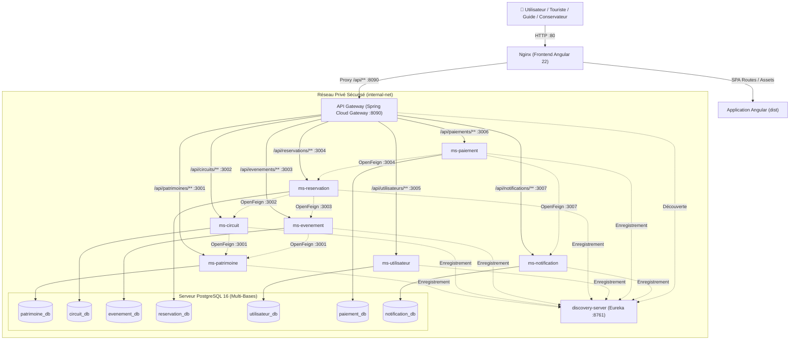

# ARCHITECTURE CIBLE — PLATEFORME DE GESTION ET DE VALORISATION DU PATRIMOINE TOURISTIQUE DE LA CASAMANCE
**Document d'Architecture Technique (DAT) — Référence P01**  
**Université Assane Seck de Ziguinchor (UASZ)** — Département Informatique  

---

## 1. VISION ET PRINCIPES DIRECTEURS

La plateforme de valorisation du patrimoine touristique de la Casamance s'inscrit dans une démarche de modernisation numérique visant à promouvoir le patrimoine culturel, historique et naturel du Sud du Sénégal (Ziguinchor, Oussouye, Cap Skirring, Enampore, Bignona, Sédhiou, Kolda).

Les principes directeurs de l'architecture cible sont :
1. **Découplage strict des domaines métier (Domain-Driven Design)** : chaque sous-domaine fonctionnel est encapsulé dans un microservice dédié et autonome.
2. **Database-per-Service** : étanchéité absolue de la persistance des données. Aucun partage de schéma ou de tables entre services ; interdiction formelle des jointures SQL distribuées.
3. **Contrat d'API d'abord (API-First)** : les échanges sont normalisés via des DTO et des contrats REST stricts.
4. **Front unique de référence** : Angular 22 (Standalone Components, Signals, architecture unifiée avec reverse proxy Nginx).
5. **Configuration déclarative par environnement** : élimination du Config Server au profit de variables d'environnement standardisées et de profils Spring Boot (`dev`, `test`, `prod`).
6. **Sécurité en profondeur et isolation réseau** : les microservices métier ne sont plus directement exposés sur le réseau public ; ils résident sur un réseau privé interne (`internal-net`) accessible uniquement via l'API Gateway (`api-gateway`) et Nginx.

---

## 2. DIAGRAMME DE L'ARCHITECTURE CIBLE (MERMAID)

---

## 3. COMPOSANTS DE L'ARCHITECTURE

### 3.1 Frontend Web (Angular 22)
- **Rôle** : Interface utilisateur réactive, accessible et moderne.
- **Technologies** : Angular 22 (Standalone Components, Signals, typed forms, Lucide Icons, Leaflet pour la cartographie des sites de Casamance).
- **Hébergement** : Nginx Alpine servant les bundles statiques pré-compilés et relayant les requêtes `/api/` de manière transparente vers `api-gateway:8090`.

### 3.2 API Gateway (Spring Cloud Gateway WebMVC)
- **Rôle** : Point d'entrée unique de toutes les requêtes REST de l'application cliente.
- **Port** : `8090` (normalisé et harmonisé).
- **Fonctions** : Routage dynamique vers les 7 microservices métier, point d'application futur des filtres d'authentification JWT (P02), métriques et Actuator.

### 3.3 Annuaire de Services (Netflix Eureka Discovery Server)
- **Rôle** : Découverte et enregistrement dynamique des instances de services.
- **Port** : `8761`.
- **Fonctions** : Résilience, équilibrage de charge côté client (Spring Cloud LoadBalancer), résolution dynamique des endpoints.

### 3.4 Les Sept Microservices Métier
1. **`ms-patrimoine` (port 3001)** : Registre officiel des biens patrimoniaux (culturels, historiques, architecturaux et naturels). Contient les coordonnées GPS, les descriptifs historiques, les jauges de capacité.
2. **`ms-circuit` (port 3002)** : Composition des itinéraires de visite touristique en plusieurs étapes ordonnées. Calcule la durée estimée et la distance géographique totale (formule de Haversine).
3. **`ms-evenement` (port 3003)** : Gestion des festivals, expositions, ateliers et visites guidées programmés sur un site patrimonial donné.
4. **`ms-reservation` (port 3004)** : Gestion du cycle de vie des réservations (création, confirmation, annulation). Vérifie la capacité restante auprès de `ms-circuit` ou `ms-evenement`.
5. **`ms-utilisateur` (port 3005)** : Annuaire des utilisateurs, gestion des comptes et attribution des 5 rôles métier cibles.
6. **`ms-paiement` (port 3006)** : Simulation des flux de paiement (Wave, Orange Money, Carte Bancaire, Espèces), confirmation de transaction vers `ms-reservation` et déclenchement de notification vers `ms-notification`.
7. **`ms-notification` (port 3007)** : Dispatching et archivage des messages de confirmation et rappels (Email / SMS).

---

## 4. MODÈLE DE DONNÉES ET ISOLATION (DATABASE-PER-SERVICE)

Chaque microservice dispose de son propre schéma PostgreSQL isolé dans une base dédiée :
- Aucun service n'a accès aux tables d'un autre service.
- Les identifiants distants (`patrimoineId`, `circuitId`, `evenementId`, `reservationId`) sont stockés sous forme de scalaires (`BIGINT`) sans clé étrangère SQL inter-bases.
- La cohérence relationnelle est assurée au niveau applicatif via OpenFeign et des validations synchrones d'existence et de disponibilité.
