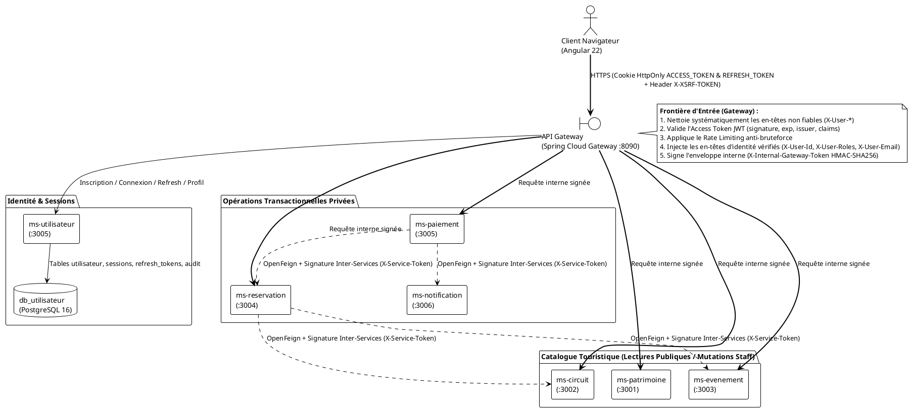
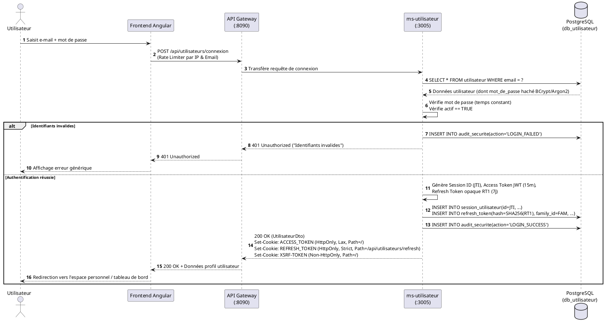
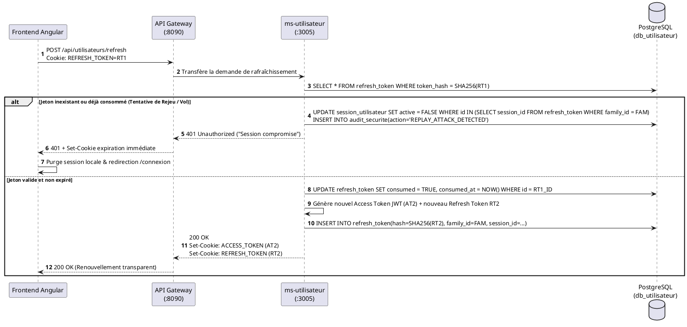
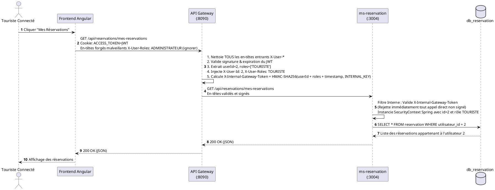
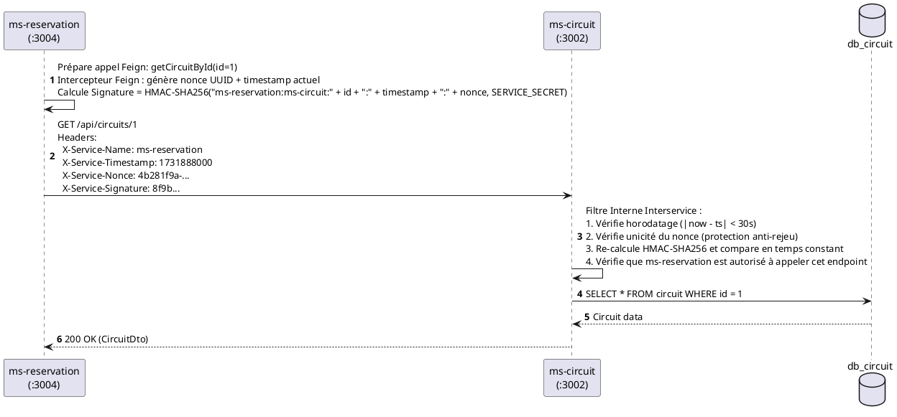

# ARCHITECTURE DE SÉCURITÉ CIBLE — PHASE P02
## Plateforme de Gestion et de Valorisation du Patrimoine Touristique de la Casamance — UASZ

---

## 1. VISION D'ENSEMBLE ET FRONTIÈRES DE CONFIANCE

La sécurité de la plateforme repose sur une architecture de confiance zéro (Zero Trust Network Architecture) adaptée aux microservices Spring Cloud. Aucune composante ne fait aveuglément confiance au réseau interne sans validation cryptographique formelle.

---

## 2. DUAL-TOKEN PATTERN : GESTION DES JETONS ET ROTATION

### 2.1 Spécification de l'Access Token (JWT)
- **Format :** JSON Web Token (RFC 7519) standardisé.
- **Algorithme de signature :** HMAC-SHA256 (`HS256`) avec clé secrète minimale de 256 bits d'entropie.
- **Durée de vie (TTL) :** **15 minutes** (900 secondes).
- **Claims standard :**
  - `sub` : Identifiant de l'utilisateur (ex: `"2"`).
  - `email` : Adresse e-mail professionnelle ou personnelle (ex: `"moussa.diop@zig.univ.sn"`).
  - `roles` : Liste des rôles attribués (ex: `["TOURISTE"]`).
  - `iss` : `"uasz-patrimoine-auth"`.
  - `aud` : `"uasz-patrimoine-platform"`.
  - `iat` : Date d'émission en secondes Epoch.
  - `exp` : Date d'expiration en secondes Epoch (`iat + 900`).
  - `jti` : Identifiant unique de session UUID v4 liant le jeton à une entrée active en base de données.

### 2.2 Spécification du Refresh Token et Rotation Anti-Rejeu
- **Format :** Jeton opaque aléatoire cryptographiquement fort (64 caractères hexadécimaux / 256 bits générés via `SecureRandom`).
- **Durée de vie (TTL) :** **7 jours** (604 800 secondes).
- **Stockage en base :** Seul le condensat **SHA-256** du jeton est persisté en base de données (`token_hash`).
- **Algorithme de rotation atomique :**
  1. Lors de l'utilisation d'un refresh token $RT_n$, le serveur vérifie si $RT_n$ existe en base.
  2. **Détection de vol/rejeu :** Si $RT_n$ a déjà le drapeau `consumed = TRUE`, une tentative de réutilisation frauduleuse est détectée. Le serveur invalide immédiatement **toute la famille de sessions (`family_id`)** et journalise un incident critique dans `audit_securite`.
  3. Si $RT_n$ est valide et non consommé :
     - Il est marqué `consumed = TRUE` avec `consumed_at = CURRENT_TIMESTAMP`.
     - Un nouveau refresh token $RT_{n+1}$ est généré et stocké dans la même famille.
     - Un nouvel Access Token JWT est émis.

---

## 3. DIAGRAMMES DE SÉQUENCE SÉCURISÉE (PlantUML)

### 3.1 Authentification et Connexion

### 3.2 Renouvellement de Jeton avec Rotation Atomique

### 3.3 Requête Authentifiée Traversant le Gateway vers un Microservice

### 3.4 Communication Interservices Sécurisée (OpenFeign)

---

## 4. MODÈLE DE MENACES ET MITIGATIONS

| Menace | Vecteur d'attaque | Mesure de protection P02 |
|---|---|---|
| **BOLA / IDOR** | Modification de `id` dans l'URL pour accéder aux réservations d'un tiers | Vérification côté serveur dans le contrôleur et service métier : `utilisateurId == currentUser.id` ou `ADMINISTRATEUR`. |
| **Falsification d'en-têtes** | Envoi de `X-User-Roles: ADMINISTRATEUR` par le client | Suppression obligatoire de ces en-têtes en entrée de la Gateway ; injection exclusive par la Gateway avec signature HMAC interne. |
| **Vol de Refresh Token** | Interception d'un jeton de rafraîchissement | Détection de réutilisation : toute tentative de réutiliser un refresh token déjà consommé révoque immédiatement toute la session et sa famille de jetons. |
| **Attaque par Rejeu Interne** | Capture d'une requête interservice Feign | Horodatage strict ($\pm$ 30 secondes) + Nonce unique consommé une seule fois en cache / registre d'invalidation. |
| **Force Brute Connexion** | Tentatives massives sur `/api/utilisateurs/connexion` | Limitation de débit (Rate Limiting) au niveau de la Gateway et journalisation des échecs d'authentification. |
| **Énumération de comptes** | Comparaison des messages d'erreur à la connexion | Message d'erreur unique : *"Identifiants de connexion invalides."* quel que soit le cas d'erreur. |
