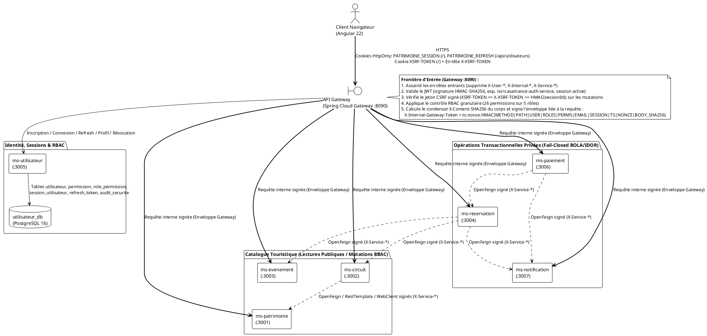
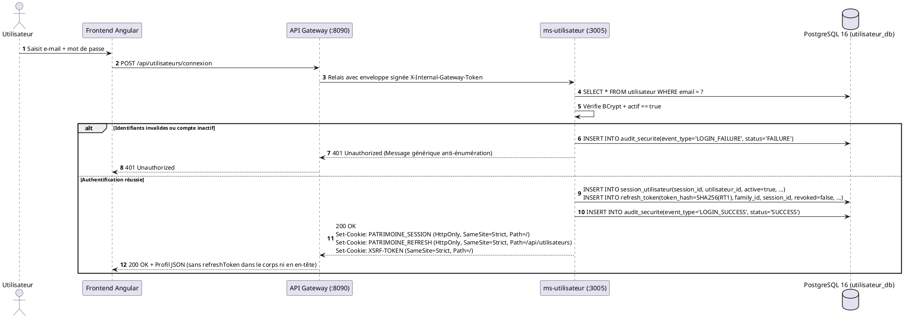
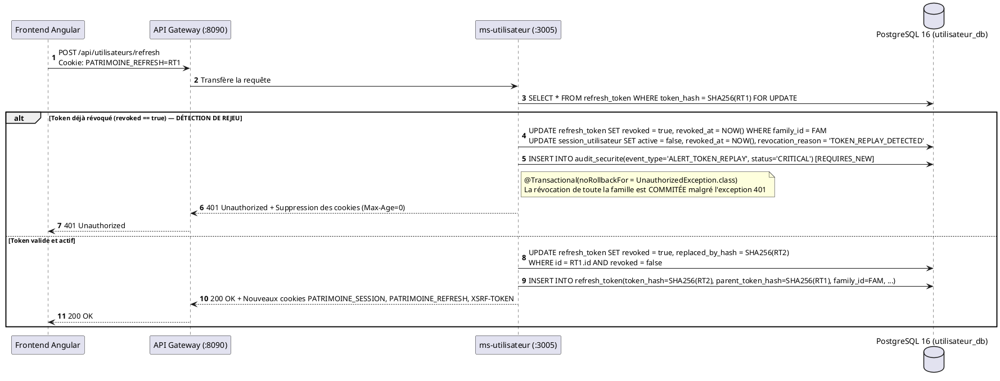

# ARCHITECTURE DE SÉCURITÉ CIBLE — PHASE P02 (RÉVISÉE P02-CORRECTION)
## Plateforme de Gestion et de Valorisation du Patrimoine Touristique de la Casamance — UASZ

---

## 1. VISION D'ENSEMBLE ET FRONTIÈRES DE CONFIANCE

La sécurité de la plateforme repose sur une architecture de confiance zéro (*Zero Trust Network Architecture*) adaptée aux microservices Spring Cloud. Aucune composante ne fait aveuglément confiance au réseau interne sans validation cryptographique formelle de l'intégrité de la requête, de l'identité propagée et des droits d'accès.

### Cartographie des Ports et Services

| Composant | Rôle | Port Interne / Défaut | Base de Données PostgreSQL 16 |
| :--- | :--- | :---: | :--- |
| `discovery-server` | Registre Eureka | `:8761` | — |
| `api-gateway` | Passerelle d'entrée Zero-Trust, JWT, CSRF, RBAC, Rate-Limiting | `:8090` | — |
| `ms-patrimoine` | Gestion du patrimoine matériel et immatériel | `:3001` | `patrimoine_db` |
| `ms-circuit` | Gestion des circuits touristiques | `:3002` | `circuit_db` |
| `ms-evenement` | Gestion des événements culturels | `:3003` | `evenement_db` |
| `ms-reservation` | Gestion des réservations (protégé BOLA/IDOR) | `:3004` | `reservation_db` |
| `ms-utilisateur` | Fournisseur d'identité, sessions, RBAC, audit de sécurité | `:3005` | `utilisateur_db` |
| `ms-paiement` | Gestion des paiements Mobile Money simulés (protégé BOLA/IDOR) | `:3006` | `paiement_db` |
| `ms-notification` | Émission et journalisation des notifications | `:3007` | `notification_db` |



---

## 2. GESTION DES SECRETS CRYPTOGRAPHIQUES (ZÉRO CLÉ DE SECOURS)

### 2.1 Politique Fail-Fast au Démarrage
Aucune clé secrète par défaut, de démonstration ou de secours (`dev-secret-*`, `change-me`, etc.) n'est présente dans le code source ni dans les fichiers `application.yml`.
Les huit microservices et l'`api-gateway` exigent impérativement deux variables d'environnement distinctes au démarrage :
- `SECURITY_SESSION_SECRET` : Clé secrète symétrique dédiée à la signature des Access Tokens JWT et des jetons CSRF liés à la session (`ms-utilisateur` et `api-gateway`).
- `SECURITY_INTERSERVICE_SECRET` : Clé secrète symétrique dédiée à la signature de l'enveloppe Gateway (`X-Internal-Gateway-Token`) et des appels interservices (`X-Service-Signature`).

Au démarrage (`@PostConstruct` / constructeur), chaque service valide strictement les clés :
1. **Présence obligatoire** : Rejet immédiat (`IllegalStateException`) si la clé est absente ou vide.
2. **Longueur minimale** : Au moins **32 octets** (256 bits) en UTF-8.
3. **Qualité cryptographique (entropie)** : Au moins **10 caractères distincts** et rejet de tout motif interdit (`dev-secret`, `change-me`, `change_me`, `default`, `secret-key`, `placeholder`, `example`, `password`, `123456`, `casamance-dev`).
4. **Séparation des domaines cryptographiques** : Dans `api-gateway`, `SECURITY_SESSION_SECRET` et `SECURITY_INTERSERVICE_SECRET` ne peuvent pas être identiques.

### 2.2 Procédure de Génération et de Rotation des Secrets
1. **Génération initiale (CSPRNG 384 bits en Base64)** :
   ```bash
   export SECURITY_SESSION_SECRET="$(openssl rand -base64 48 | tr -d '\n')"
   export SECURITY_INTERSERVICE_SECRET="$(openssl rand -base64 48 | tr -d '\n')"
   ```
2. **Rotation de `SECURITY_SESSION_SECRET`** :
   - Générer une nouvelle clé CSPRNG d'au moins 48 octets encodés en Base64.
   - Déployer la nouvelle valeur simultanément sur `ms-utilisateur` et `api-gateway` via le gestionnaire de secrets (Docker Compose `.env` / GitHub Actions Secrets) et redémarrer les deux conteneurs.
   - Impact : Les Access Tokens en cours (TTL max 15 minutes) sont invalidés ; les utilisateurs obtiennent un nouvel Access Token signé avec la nouvelle clé via leur cookie `PATRIMOINE_REFRESH` (ou se reconnectent).
3. **Rotation de `SECURITY_INTERSERVICE_SECRET`** :
   - Générer une nouvelle clé CSPRNG distincte de `SECURITY_SESSION_SECRET`.
   - Mettre à jour la variable d'environnement sur `api-gateway` et les 7 microservices métier (`ms-patrimoine`, `ms-circuit`, `ms-evenement`, `ms-reservation`, `ms-utilisateur`, `ms-paiement`, `ms-notification`), puis effectuer un redémarrage coordonné (`docker compose up -d --force-recreate`).

---

## 3. DUAL-TOKEN PATTERN : SPÉCIFICATION DES JETONS ET COOKIES

### 3.1 Access Token (JWT RFC 7519)
- **Algorithme :** HMAC-SHA256 (`HS256`).
- **Durée de vie (TTL) :** **15 minutes** (900 secondes).
- **Émetteur (`iss`) :** `"casamance-auth-service"`.
- **Claims signés :**
  - `sub` : Identifiant numérique de l'utilisateur (ex: `"2"`).
  - `email` : Adresse e-mail de l'utilisateur.
  - `role` : Rôle métier actif (`TOURISTE`, `GUIDE`, `CONSERVATEUR`, `GESTIONNAIRE_SITE`, `ADMINISTRATEUR`).
  - `permissions` : Tableau explicite des permissions issues de la table `role_permission`.
  - `sessionId` : Identifiant UUID de la session dans `session_utilisateur`.
  - `jti` : Identifiant unique du jeton UUID v4.
  - `iat` / `exp` : Horodatages Epoch en secondes (`exp = iat + 900`).

### 3.2 Refresh Token Opaque et Rotation Atomique Anti-Rejeu
- **Format :** Jeton opaque de 64 caractères hexadécimaux (256 bits issus de `SecureRandom`), **jamais exposé dans un en-tête HTTP** (`X-Refresh-Token` supprimé en lecture comme en écriture).
- **Durée de vie (TTL) :** **7 jours** (604 800 secondes).
- **Stockage SQL (`refresh_token`) :**
  - `token_hash` (`VARCHAR(64) UNIQUE`) : Condensat SHA-256 du jeton.
  - `family_id` (`VARCHAR(64)`) : Identifiant de la famille de rotation.
  - `session_id` (`VARCHAR(64)`) : Référence à `session_utilisateur.session_id`.
  - `revoked` (`BOOLEAN`), `revoked_at` (`TIMESTAMP`), `replaced_by_hash` (`VARCHAR(64)`).
  - `parent_token_hash` (`VARCHAR(64) UNIQUE`, migration Flyway V4 `uk_refresh_token_parent_hash`) : Garantit au niveau du moteur PostgreSQL 16 qu'un même jeton parent ne peut jamais engendrer deux jetons successeurs valides.

### 3.3 Cookies de Sécurité et Protection CSRF
| Nom du Cookie | `HttpOnly` | `Secure` | `SameSite` | `Path` | `Max-Age` | Rôle |
| :--- | :---: | :---: | :---: | :---: | :---: | :--- |
| `PATRIMOINE_SESSION` | `true` | `true` (Prod/HTTPS) | `Strict` | `/` | `900` (15m) | Transport du JWT d'accès |
| `PATRIMOINE_REFRESH` | `true` | `true` (Prod/HTTPS) | `Strict` | `/api/utilisateurs` | `604800` (7j) | Transport exclusif du Refresh Token |
| `XSRF-TOKEN` | `false` | `true` (Prod/HTTPS) | `Strict` | `/` | `900` (15m) | Jeton CSRF signé `HMAC-SHA256("CSRF:" + sessionId)` |

Toute requête mutative (`POST`, `PUT`, `PATCH`, `DELETE`) authentifiée par cookie `PATRIMOINE_SESSION` doit présenter l'en-tête `X-XSRF-TOKEN` correspondant à la fois au cookie `XSRF-TOKEN` et à la signature HMAC serveur liée au `sessionId` du JWT.

---

## 4. DIAGRAMMES DE SÉQUENCE SÉCURISÉE

### 4.1 Connexion et Émission des Cookies


### 4.2 Renouvellement Atomique et Détection de Rejeu Persistante

