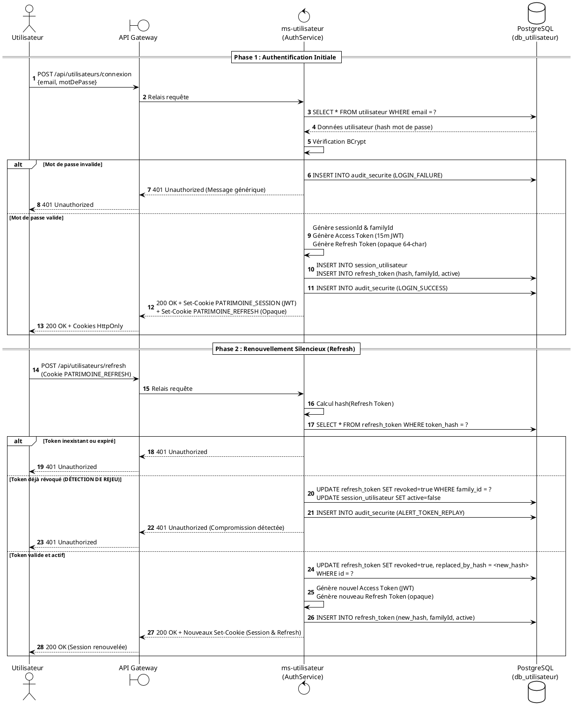

# ARCHITECTURE D'AUTHENTIFICATION ET DE GESTION DES SESSIONS — PHASE P02
## Plateforme de Gestion et de Valorisation du Patrimoine Touristique de la Casamance — UASZ

---

## 1. STRATÉGIE GLOBALE : LE PATTERN DUAL-TOKEN

Pour concilier performance stateless des microservices et contrôle strict du cycle de vie des sessions, la plateforme adopte le pattern **Dual-Token** :

```
Client (Angular 22)
       │
       ├─── Requêtes métier standard ───►  Access Token (JWT, 15 min, en Cookie HttpOnly ou Bearer)
       │                                  Validé cryptographiquement sans requête DB
       │
       └─── Expiration du JWT (401)  ───►  Refresh Token (Opaque 256-bit, 7 jours, en Cookie HttpOnly)
                                          Validé et tourné de manière atomique en base PostgreSQL
```

---

## 2. SPÉCIFICATIONS DU JETON D'ACCÈS (ACCESS TOKEN JWT)

L'Access Token est un JSON Web Token (JWT RFC 7519) signé avec l'algorithme HMAC-SHA256 (`HS256`).

### Structure du Header :
```json
{
  "alg": "HS256",
  "typ": "JWT"
}
```

### Structure du Payload (Claims) :
```json
{
  "iss": "casamance-auth-service",
  "sub": "2",
  "email": "moussa.diop@zig.univ.sn",
  "role": "TOURISTE",
  "permissions": [
    "PATRIMOINE:LIRE",
    "CIRCUIT:LIRE",
    "EVENEMENT:LIRE",
    "RESERVATION:CREER",
    "RESERVATION:LIRE_PROPRE",
    "RESERVATION:ANNULER_PROPRE",
    "PAIEMENT:INITIER",
    "PAIEMENT:LIRE_PROPRE",
    "UTILISATEUR:LIRE_PROFIL"
  ],
  "sessionId": "a1b2c3d4-e5f6-7890-abcd-ef1234567890",
  "jti": "987fcdeb-51a2-4321-fedc-ba0987654321",
  "iat": 1731888000,
  "exp": 1731888900
}
```

### Règles de validation :
- **Durée de vie :** 15 minutes (900 secondes).
- **Contrôle d'émetteur (`iss`) :** Doit correspondre strictement à `casamance-auth-service`.
- **Tolérance d'horloge :** Aucune tolérance supérieure à 5 secondes.
- **Secret :** Clé cryptographique symétrique d'au moins 256 bits (32 octets) gérée via `${SECURITY_SESSION_SECRET}`.

---

## 3. SPÉCIFICATIONS DU JETON DE RENOUVELLEMENT (REFRESH TOKEN)

Le Refresh Token est une chaîne opaque cryptographiquement aléatoire (32 octets encodés en hexadécimal, 64 caractères).

### Principes de sécurité appliqués :
1. **Stockage sous forme de hash :** Le token en clair n'est jamais stocké dans PostgreSQL. Seul son condensat `SHA-256` est persisté dans la colonne `refresh_token.token_hash`.
2. **Rotation systématique (RTR - Refresh Token Rotation) :** À chaque appel à `/api/utilisateurs/refresh`, le refresh token soumis est immédiatement invalidé (`revoked = TRUE`, `replaced_by_hash = <nouveau_hash>`), et un nouveau couple (Access Token + Refresh Token) est émis.
3. **Familles de jetons (`family_id`) :** Tous les refresh tokens issus d'une même session de connexion partagent le même `family_id` (UUID).
4. **Détection de réutilisation (Replay Attack Detection) :** Si un refresh token déjà révoqué est présenté, le système détecte une compromission potentielle (vol de jeton par un attaquant) :
   - Toute la famille (`family_id`) est révoquée immédiatement en base de données.
   - La session utilisateur associée est marquée inactive.
   - Une alerte critique est enregistrée dans `audit_securite` (`ALERT_TOKEN_REPLAY`).
   - La requête est rejetée avec HTTP 401 Unauthorized.
5. **Atomicité des opérations :** La rotation et la détection s'exécutent au sein d'une transaction `@Transactional` avec verrouillage pessimiste ou contrôle de concurrence strict pour éviter les conditions de course lors de requêtes concurrentes.

---

## 4. SCHÉMA DE SÉQUENCE : CONNEXION ET RENOUVELLEMENT DE SESSION



---

## 5. DÉCONNEXION ET RÉVOCATION PERSISTANTE

Contrairement à l'ancienne implémentation qui stockait les `jti` révoqués dans une `ConcurrentHashMap` en mémoire (perdue à chaque redémarrage de conteneur), la révocation est désormais **persistante** :

1. **Déconnexion volontaire (`POST /api/utilisateurs/deconnexion`) :**
   - La session associée au jeton est marquée `active = FALSE` dans la table `session_utilisateur`.
   - Tous les refresh tokens de la session sont marqués `revoked = TRUE`.
   - Les cookies `PATRIMOINE_SESSION` et `PATRIMOINE_REFRESH` sont supprimés côté client en renvoyant des en-têtes `Set-Cookie` avec `Max-Age=0`.
   - L'événement est consigné dans `audit_securite` (`LOGOUT`).

2. **Révocation administrative (`POST /api/utilisateurs/{id}/revoquer-sessions`) :**
   - Un administrateur peut révoquer instantanément toutes les sessions d'un utilisateur suspecté de compromission.

---

## 6. GESTION DES ERREURS ET PROTECTION ANTI-ÉNUMÉRATION

Pour neutraliser la vulnérabilité `SEC-VULN-11` (énumération des comptes existants) :
- En cas d'échec d'authentification (email inexistant ou mot de passe erroné), le service retourne systématiquement le même message d'erreur générique :
  ```json
  {
    "statut": 401,
    "erreur": "Identifiants invalides. Vérifiez votre adresse email et votre mot de passe."
  }
  ```
- Les temps de réponse sont homogénéisés pour prévenir les attaques temporelles (timing attacks).
