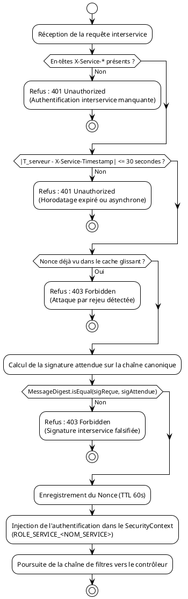

# SÉCURISATION DES COMMUNICATIONS INTERSERVICES — PHASE P02
## Plateforme de Gestion et de Valorisation du Patrimoine Touristique de la Casamance — UASZ

---

## 1. CONTEXTE ET PROBLÉMATIQUE DE SÉCURITÉ

Dans l'architecture microservices déployée sur le réseau Docker `app-net`, deux vulnérabilités critiques ont été mises en évidence lors de l'audit initial :
1. **`SEC-VULN-02` (Absence de filtre de sécurité sur les microservices) :** Tout conteneur ou processus connecté à `app-net` peut envoyer des requêtes HTTP directes aux ports d'écoute des microservices métier sans passer par le Gateway.
2. **`SEC-VULN-03` / `SEC-VULN-06` (Usurpation d'identité et rejeu) :** Les microservices se fiaient aveuglément aux en-têtes HTTP `X-User-Id` et `X-User-Roles` sans vérifier leur authenticité cryptographique, et les appels OpenFeign (ex: `ms-reservation` -> `ms-circuit`, `ms-paiement` -> `ms-reservation`) étaient dépourvus d'authentification et de protection anti-rejeu.

Pour instaurer un modèle Zero Trust étanche, la phase P02 déploie deux mécanismes cryptographiques complémentaires :
- **Le jeton d'enveloppe Gateway (`X-Internal-Gateway-Token`)** pour le trafic Nord-Sud.
- **Le protocole signé avec Nonce et Horodatage (`X-Service-*`)** pour le trafic Est-Ouest (OpenFeign).

---

## 2. TRAFIC NORD-SUD : ENVELOPPE SIGNÉE DU GATEWAY

Lorsqu'une requête externe traverse le Spring Cloud Gateway, le filtre `GatewayAuthorizationFilter` applique la séquence de durcissement suivante :

```
Client Externe (Internet)
       │
       │  Envoie potentiellement de faux en-têtes (ex: X-User-Roles: ADMINISTRATEUR)
       ▼
┌────────────────────────────────────────────────────────────────────────┐
│ API GATEWAY (:8090)                                                    │
│ 1. ASSAINISSEMENT : Suppression de X-User-Id, X-User-Roles, etc.        │
│ 2. VALIDATION : Vérification cryptographique du JWT (PATRIMOINE_SESSION)│
│ 3. ENRICHISSEMENT : Injection des claims vérifiés                      │
│ 4. SIGNATURE : Génération de X-Internal-Gateway-Token                   │
└────────────────────────────────────────────────────────────────────────┘
       │
       │  X-User-Id: 2
       │  X-User-Roles: TOURISTE
       │  X-Internal-Gateway-Token: HMAC-SHA256(userId + ":" + role + ":" + ts, secret)
       ▼
Microservice Métier (:3001..:3007)
  Vérifie X-Internal-Gateway-Token avant de faire confiance à X-User-*
```

### Format du Jeton d'Enveloppe Interne :
L'en-tête `X-Internal-Gateway-Token` est structuré sous la forme :
```
<timestamp_epoch_seconds>.<signature_base64url>
```
La signature est calculée comme suit :
$$\text{Signature} = \text{HMAC-SHA256}_{K_{gateway}}(\text{userId} \parallel \text{":"} \parallel \text{role} \parallel \text{":"} \parallel \text{timestamp})$$

- Si la requête est anonyme (lecture publique du catalogue), le Gateway signe avec `userId = "ANONYMOUS"` et `role = "PUBLIC"`.
- Tout microservice rejettera avec HTTP 403 Forbidden une requête dont la signature interne est absente, invalide ou expirée ($> 30$ secondes).

---

## 3. TRAFIC EST-OUEST : PROTOCOLE FEIGN SIGNÉ ANTI-REJEU

Lorsque des microservices communiquent entre eux (par exemple `ms-reservation` vérifiant l'existence d'un circuit dans `ms-circuit`), ils utilisent OpenFeign. 

Pour authentifier le service appelant et prévenir toute attaque par rejeu (replay attack), chaque requête Feign est signée dynamiquement via un intercepteur dédié : `InterserviceFeignSecurityInterceptor`.

### 3.1 En-têtes injectés :

| En-tête | Type | Description |
| :--- | :--- | :--- |
| `X-Service-Name` | String | Nom du service émetteur (ex: `ms-reservation`) |
| `X-Service-Timestamp` | Long | Horodatage Unix en secondes au moment de l'émission |
| `X-Service-Nonce` | UUID | Identifiant unique aléatoire émis pour cette requête |
| `X-Service-Signature` | String | Condensat HMAC-SHA256 encodé en Base64URL |
| `X-User-Id` | Long (optionnel) | Propagation de l'identité de l'utilisateur à l'origine de l'action |
| `X-User-Roles` | String (optionnel) | Propagation des rôles de l'utilisateur d'origine |

### 3.2 Canonicalisation et calcul de la signature :

Pour garantir l'intégrité de la requête, la chaîne canonique inclut la méthode, le chemin, le nom du service, l'horodatage et le nonce :

$$\text{CanonicalString} = \text{METHOD} \parallel \text{"\|"} \parallel \text{PATH} \parallel \text{"\|"} \parallel \text{SERVICE\_NAME} \parallel \text{"\|"} \parallel \text{TIMESTAMP} \parallel \text{"\|"} \parallel \text{NONCE}$$

Exemple :
`GET|/api/circuits/10|ms-reservation|1731888120|550e8400-e29b-41d4-a716-446655440000`

La signature est générée avec la clé partagée `${security.interservice.secret}` :
$$\text{X-Service-Signature} = \text{Base64Url}(\text{HMAC-SHA256}_{K_{interservice}}(\text{CanonicalString}))$$

---

## 4. VALIDATION ET PROTECTION ANTI-REJEU CÔTÉ DESTINATAIRE

À la réception d'une requête interservice, le filtre de sécurité `InterserviceAuthFilter` du microservice cible exécute cinq contrôles séquentiels :



### Caractéristiques de l'implémentation :
1. **Comparaison en temps constant :** Utilisation systématique de `MessageDigest.isEqual()` pour neutraliser les attaques par canal auxiliaire (timing attacks).
2. **Mémoire glissante du cache Nonce :** Utilisation d'un cache LRU expirable (Caffeine ou ConcurrentHashMap avec purge temporelle) limitant l'empreinte mémoire à moins de 5 Mo pour 10 000 requêtes/minute.
3. **Tolérance aux dérives d'horloge :** La fenêtre de validité de $\pm 30$ secondes est adaptée aux environnements conteneurisés Docker synchronisés par NTP.

---

## 5. MATRICE DES FLUX INTERSERVICES AUTORISÉS

Pour appliquer le principe du moindre privilège entre microservices, seuls les flux métiers documentés sont autorisés :

| Émetteur | Destinataire | Endpoint Cible | Justification Métier |
| :--- | :--- | :--- | :--- |
| `ms-reservation` | `ms-circuit` | `GET /api/circuits/{id}` | Vérification de validité et tarif du circuit |
| `ms-reservation` | `ms-evenement`| `GET /api/evenements/{id}` | Vérification des places disponibles |
| `ms-reservation` | `ms-patrimoine`| `GET /api/patrimoines/{id}` | Contrôle d'existence du site patrimonial |
| `ms-paiement` | `ms-reservation`| `GET /api/reservations/{id}` | Validation du montant à régler |
| `ms-reservation` | `ms-notification`| `POST /api/notifications` | Envoi de confirmation de réservation |
| `ms-paiement` | `ms-notification`| `POST /api/notifications` | Envoi de reçu de paiement |

Tout autre appel interservice non répertorié est rejeté par défaut.
