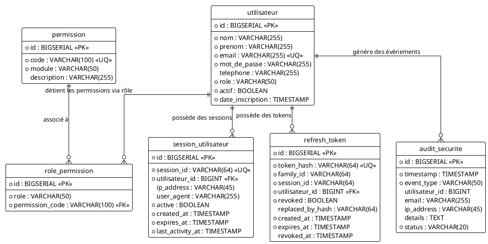

# MODÈLE DE CONTRÔLE D'ACCÈS RBAC (ROLE-BASED ACCESS CONTROL) — PHASE P02
## Plateforme de Gestion et de Valorisation du Patrimoine Touristique de la Casamance — UASZ

---

## 1. OBJECTIF ET PRINCIPES DIRECTEURS

Le modèle RBAC de la plateforme touristique de la Casamance répond aux impératifs de sécurité et d'intégrité définis par l'Université Assane Seck de Ziguinchor (UASZ). Il remplace l'ancien modèle statique mono-colonne par une structure normalisée de permissions et de rôles métier.

### Principes directeurs :
1. **Moindre privilège (Principle of Least Privilege) :** Chaque rôle ne dispose que des droits strictement nécessaires à l'exercice de ses attributions.
2. **Défense en profondeur (Defense in Depth) :** Le contrôle d'accès est exercé au Gateway (filtrage macroscopique et rejet fail-closed) ET au sein de chaque microservice métier (contrôle fin des permissions et règles horizontales BOLA).
3. **Ségrégation des devoirs (Separation of Duties) :** Un touriste ne peut pas valider ou consulter les transactions financières globales ; un conservateur gère l'intégrité culturelle mais n'administre pas les comptes système.
4. **Non-répudiation et traçabilité :** Tout changement de rôle ou attribution de droit est consigné dans la table `audit_securite`.

---

## 2. DÉFINITION DES CINQ RÔLES MÉTIER

| Rôle | Périmètre & Responsabilités | Acteur Typique |
| :--- | :--- | :--- |
| **`TOURISTE`** | Rôle attribué par défaut à l'inscription. Consultation publique du catalogue (patrimoines, circuits, événements), création et gestion de ses **propres** réservations et initiation de ses paiements. | Visiteur national/international, étudiant, chercheur |
| **`GUIDE`** | Accompagnateur touristique local en Casamance. Consultation des circuits qui lui sont affectés, suivi de ses réservations de guidage, mise à jour des notes d'étape et signalement de terrain. | Guide certifié d'Oussouye, de Carabane ou de Kafountine |
| **`CONSERVATEUR`** | Expert patrimonial et culturel. Création, enrichissement, validation historique et modification des fiches de patrimoine matériel et immatériel (sites sacrés, musées, cases à impluvium, forêts sacrées). | Enseignant-chercheur UASZ, conservateur régional |
| **`GESTIONNAIRE_SITE`** | Responsable opérationnel d'un site ou circuit touristique. Gestion des plannings d'événements, quotas de fréquentation, validation des circuits et suivi des opérations sur son périmètre. | Régisseur de site, gestionnaire de campement villageois |
| **`ADMINISTRATEUR`** | Responsable technique et de gouvernance de la plateforme. Gestion du cycle de vie des utilisateurs, attribution des rôles staff, consultation des journaux d'audit et configuration globale. | Administrateur système UASZ / DSIN |

---

## 3. MATRICE COMPLÈTE DES PERMISSIONS (CRUD & MÉTIER)

Les permissions sont identifiées de manière univoque par un code sous la forme `DOMAINE:ACTION`.

### 3.1 Catalogue Touristique (Patrimoine, Circuit, Événement)

| Code Permission | Description | Rôles Autorisés |
| :--- | :--- | :--- |
| `PATRIMOINE:LIRE` | Consultation des fiches de patrimoine | `PUBLIC`, `TOURISTE`, `GUIDE`, `CONSERVATEUR`, `GESTIONNAIRE_SITE`, `ADMINISTRATEUR` |
| `PATRIMOINE:CREER` | Création d'une nouvelle fiche patrimoniale | `CONSERVATEUR`, `ADMINISTRATEUR` |
| `PATRIMOINE:MODIFIER` | Modification d'une fiche patrimoniale | `CONSERVATEUR`, `ADMINISTRATEUR` |
| `PATRIMOINE:SUPPRIMER` | Retrait d'une fiche du catalogue | `CONSERVATEUR`, `ADMINISTRATEUR` |
| `CIRCUIT:LIRE` | Consultation des circuits touristiques | `PUBLIC`, `TOURISTE`, `GUIDE`, `CONSERVATEUR`, `GESTIONNAIRE_SITE`, `ADMINISTRATEUR` |
| `CIRCUIT:CREER` | Création d'un circuit écotouristique | `GESTIONNAIRE_SITE`, `ADMINISTRATEUR` |
| `CIRCUIT:MODIFIER` | Modification d'un circuit (étapes, prix) | `GESTIONNAIRE_SITE`, `GUIDE`, `ADMINISTRATEUR` |
| `CIRCUIT:SUPPRIMER` | Suppression d'un circuit | `GESTIONNAIRE_SITE`, `ADMINISTRATEUR` |
| `EVENEMENT:LIRE` | Consultation des événements et festivals | `PUBLIC`, `TOURISTE`, `GUIDE`, `CONSERVATEUR`, `GESTIONNAIRE_SITE`, `ADMINISTRATEUR` |
| `EVENEMENT:CREER` | Création d'un événement culturel | `GESTIONNAIRE_SITE`, `ADMINISTRATEUR` |
| `EVENEMENT:MODIFIER` | Mise à jour des dates ou quotas d'événement | `GESTIONNAIRE_SITE`, `ADMINISTRATEUR` |
| `EVENEMENT:SUPPRIMER` | Annulation ou suppression d'un événement | `GESTIONNAIRE_SITE`, `ADMINISTRATEUR` |

### 3.2 Réservations et Paiements (Règles Horizontales & Verticales)

| Code Permission | Description | Rôles Autorisés |
| :--- | :--- | :--- |
| `RESERVATION:CREER` | Créer une réservation pour son propre compte | `TOURISTE`, `ADMINISTRATEUR` |
| `RESERVATION:LIRE_PROPRE`| Consulter ses propres réservations | `TOURISTE`, `ADMINISTRATEUR` |
| `RESERVATION:LIRE_TOUT` | Consulter l'intégralité des réservations | `GESTIONNAIRE_SITE`, `ADMINISTRATEUR` |
| `RESERVATION:ANNULER_PROPRE`| Annuler sa propre réservation | `TOURISTE`, `ADMINISTRATEUR` |
| `RESERVATION:GERER` | Modifier ou forcer l'état d'une réservation | `GESTIONNAIRE_SITE`, `ADMINISTRATEUR` |
| `PAIEMENT:INITIER` | Initier un paiement de réservation | `TOURISTE`, `ADMINISTRATEUR` |
| `PAIEMENT:LIRE_PROPRE` | Consulter le reçu de son paiement | `TOURISTE`, `ADMINISTRATEUR` |
| `PAIEMENT:LIRE_TOUT` | Consulter les transactions financières globales | `ADMINISTRATEUR` |

### 3.3 Administration & Identité

| Code Permission | Description | Rôles Autorisés |
| :--- | :--- | :--- |
| `UTILISATEUR:LIRE_PROFIL`| Consulter et mettre à jour son propre profil | Tous les utilisateurs authentifiés |
| `UTILISATEUR:LIRE_TOUT` | Consulter l'annuaire des utilisateurs | `ADMINISTRATEUR` |
| `UTILISATEUR:CREER_STAFF`| Créer un compte avec rôle privilégié | `ADMINISTRATEUR` |
| `UTILISATEUR:GERER_ROLES`| Modifier le rôle ou le statut d'un compte | `ADMINISTRATEUR` |
| `UTILISATEUR:SUPPRIMER` | Clôturer ou supprimer un utilisateur | `ADMINISTRATEUR` |
| `AUDIT:LIRE` | Consulter les pistes d'audit de sécurité | `ADMINISTRATEUR` |

---

## 4. SCHÉMA RELATIONNEL DE PERSISTANCE (FLYWAY V3)

Le modèle est normalisé dans la base de données PostgreSQL de `ms-utilisateur` :

---

## 5. HIÉRARCHIE DES RÔLES ET EXPANSION DYNAMIQUE

Pour simplifier la configuration des autorisations Spring Security sans multiplier les annotations complexes, une hiérarchie de rôles est modélisée :

$$\text{ADMINISTRATEUR} \succ \text{GESTIONNAIRE\_SITE} \succ \text{CONSERVATEUR} \succ \text{TOURISTE}$$
$$\text{ADMINISTRATEUR} \succ \text{GUIDE} \succ \text{TOURISTE}$$

- Tout `ADMINISTRATEUR` hérite implicitement des droits de consultation et de gestion opérationnelle.
- Tout utilisateur connecté dispose a minima des prérogatives du rôle `TOURISTE`.

Dans le token JWT, les permissions associées au rôle sont injectées sous forme de tableau `claims["permissions"]`, permettant au Gateway et aux microservices de vérifier directement la présence d'une permission sans appel synchrone à la base de données.

---

## 6. PRÉVENTION DE L'ÉLÉVATION DE PRIVILÈGES

1. **Auto-inscription bridée :** Le contrôleur d'inscription public (`POST /api/utilisateurs`) force inconditionnellement le rôle à `TOURISTE`. Tout champ `role` fourni dans le corps JSON est écrasé côté serveur.
2. **Création staff réservée :** L'affectation de rôles privilégiés (`GUIDE`, `CONSERVATEUR`, `GESTIONNAIRE_SITE`, `ADMINISTRATEUR`) n'est permise que via l'endpoint dédié `POST /api/utilisateurs/admin`, soumis à la vérification stricte du rôle `ADMINISTRATEUR`.
3. **Immutabilité des comptes clés :** La modification du statut du compte administrateur racine (ID 1) requiert une confirmation et est auditée immédiatement.
