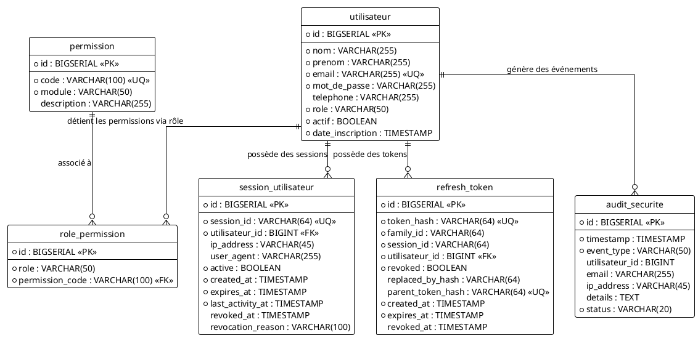

# MODÈLE DE CONTRÔLE D'ACCÈS RBAC (ROLE-BASED ACCESS CONTROL) — PHASE P02 (RÉVISÉE P02-CORRECTION)
## Plateforme de Gestion et de Valorisation du Patrimoine Touristique de la Casamance — UASZ

---

## 1. OBJECTIF ET PRINCIPES DIRECTEURS

Le modèle RBAC de la plateforme touristique de la Casamance repose sur une structure normalisée en base de données (`permission` et `role_permission`, soit **26 permissions** réparties sur **5 rôles métier**) et sur une double vérification systématique :
1. **Contrôle au niveau de l'API Gateway (`GatewayAuthorizationFilter`)** : Filtrage d'accès par route et méthode HTTP basé à la fois sur le rôle et sur les permissions explicites contenues dans le JWT (`claims["permissions"]`).
2. **Contrôle au cœur des services métier (`PatrimoineService`, `CircuitService`, `EvenementService`, `ReservationService`, `PaiementService`, `NotificationService`, `UtilisateurController`)** : Vérification fine des permissions (`SecurityUserContext.hasPermission(...)`) et de la propriété des ressources (protection BOLA/IDOR *fail-closed*).

---

## 2. DÉFINITION DES CINQ RÔLES MÉTIER

| Rôle | Périmètre & Responsabilités | Compte Démo Initialisé |
| :--- | :--- | :--- |
| **`TOURISTE`** | Rôle attribué par défaut à l'inscription. Consultation publique du catalogue, création et gestion de ses **propres** réservations et paiements. | `moussa.diop@zig.univ.sn` |
| **`GUIDE`** | Accompagnateur touristique local. Consultation et mise à jour des circuits (`CIRCUIT:MODIFIER`), consultation des réservations liées aux visites (`RESERVATION:LIRE_TOUT`). | `ousmane.badji@zig.univ.sn` |
| **`CONSERVATEUR`** | Expert patrimonial et culturel. Création, modification et suppression des fiches de patrimoine (`PATRIMOINE:CREER`, `PATRIMOINE:MODIFIER`, `PATRIMOINE:SUPPRIMER`). | `mariama.sagna@univ-zig.sn` |
| **`GESTIONNAIRE_SITE`** | Responsable opérationnel des circuits, événements et réservations (`CIRCUIT:*`, `EVENEMENT:*`, `RESERVATION:LIRE_TOUT`, `RESERVATION:GERER`, `RESERVATION:MODIFIER_STATUT`). | `ibrahima.coly@zig.univ.sn` |
| **`ADMINISTRATEUR`** | Gouvernance complète de la plateforme, gestion des comptes et rôles staff, consultation globale des paiements, notifications et journaux d'audit (`AUDIT:LIRE`). | `lamine.faty@univ-zig.sn` |

---

## 3. MATRICE EXHAUSTIVE DES 26 PERMISSIONS (BASE DE DONNÉES & MÉTIER)

### 3.1 Catalogue Touristique (`ms-patrimoine`, `ms-circuit`, `ms-evenement`)

| Code Permission | Description | Rôles Autorisés |
| :--- | :--- | :--- |
| `PATRIMOINE:LIRE` | Consultation des fiches de patrimoine | `PUBLIC`, `TOURISTE`, `GUIDE`, `CONSERVATEUR`, `GESTIONNAIRE_SITE`, `ADMINISTRATEUR` |
| `PATRIMOINE:CREER` | Création d'une fiche patrimoniale | `CONSERVATEUR`, `ADMINISTRATEUR` |
| `PATRIMOINE:MODIFIER` | Modification d'une fiche patrimoniale | `CONSERVATEUR`, `ADMINISTRATEUR` |
| `PATRIMOINE:SUPPRIMER` | Suppression d'une fiche patrimoniale | `CONSERVATEUR`, `ADMINISTRATEUR` |
| `CIRCUIT:LIRE` | Consultation des circuits touristiques | `PUBLIC`, `TOURISTE`, `GUIDE`, `CONSERVATEUR`, `GESTIONNAIRE_SITE`, `ADMINISTRATEUR` |
| `CIRCUIT:CREER` | Création d'un circuit touristique | `GESTIONNAIRE_SITE`, `ADMINISTRATEUR` |
| `CIRCUIT:MODIFIER` | Modification d'un circuit | `GUIDE`, `GESTIONNAIRE_SITE`, `ADMINISTRATEUR` |
| `CIRCUIT:SUPPRIMER` | Suppression d'un circuit | `GESTIONNAIRE_SITE`, `ADMINISTRATEUR` |
| `EVENEMENT:LIRE` | Consultation des événements et festivals | `PUBLIC`, `TOURISTE`, `GUIDE`, `CONSERVATEUR`, `GESTIONNAIRE_SITE`, `ADMINISTRATEUR` |
| `EVENEMENT:CREER` | Création d'un événement culturel | `GESTIONNAIRE_SITE`, `ADMINISTRATEUR` |
| `EVENEMENT:MODIFIER` | Modification d'un événement | `GESTIONNAIRE_SITE`, `ADMINISTRATEUR` |
| `EVENEMENT:SUPPRIMER` | Suppression d'un événement | `GESTIONNAIRE_SITE`, `ADMINISTRATEUR` |

### 3.2 Réservations, Paiements et Notifications (`ms-reservation`, `ms-paiement`, `ms-notification`)

| Code Permission | Description | Rôles Autorisés |
| :--- | :--- | :--- |
| `RESERVATION:CREER` | Créer une réservation pour son propre compte | `TOURISTE`, `GUIDE`, `CONSERVATEUR`, `GESTIONNAIRE_SITE`, `ADMINISTRATEUR` |
| `RESERVATION:LIRE_PROPRE` | Consulter ses propres réservations | `TOURISTE`, `GUIDE`, `CONSERVATEUR`, `GESTIONNAIRE_SITE`, `ADMINISTRATEUR` |
| `RESERVATION:LIRE_TOUT` | Consulter toutes les réservations | `GUIDE`, `GESTIONNAIRE_SITE`, `ADMINISTRATEUR` |
| `RESERVATION:ANNULER_PROPRE` | Annuler sa propre réservation | `TOURISTE`, `GUIDE`, `CONSERVATEUR`, `GESTIONNAIRE_SITE`, `ADMINISTRATEUR` |
| `RESERVATION:GERER` | Gérer ou annuler toute réservation | `GESTIONNAIRE_SITE`, `ADMINISTRATEUR` |
| `RESERVATION:MODIFIER_STATUT` | Modifier le statut d'une réservation | `GESTIONNAIRE_SITE`, `ADMINISTRATEUR` |
| `PAIEMENT:INITIER` | Initier un paiement pour sa propre réservation | `TOURISTE`, `GUIDE`, `CONSERVATEUR`, `GESTIONNAIRE_SITE`, `ADMINISTRATEUR` |
| `PAIEMENT:LIRE_PROPRE` | Consulter ses propres transactions de paiement | `TOURISTE`, `GUIDE`, `CONSERVATEUR`, `GESTIONNAIRE_SITE`, `ADMINISTRATEUR` |
| `PAIEMENT:LIRE_TOUT` | Consulter l'ensemble des transactions et supprimer un paiement | `ADMINISTRATEUR` |

### 3.3 Identité, Administration et Audit (`ms-utilisateur`)

| Code Permission | Description | Rôles Autorisés |
| :--- | :--- | :--- |
| `UTILISATEUR:LIRE_PROFIL` | Consulter son propre profil | Tous les rôles authentifiés |
| `UTILISATEUR:MODIFIER_PROPRE` | Modifier son propre profil (hors élévation de rôle) | Tous les rôles authentifiés |
| `UTILISATEUR:LIRE_TOUT` | Consulter l'annuaire complet des utilisateurs | `ADMINISTRATEUR` |
| `UTILISATEUR:CREER_STAFF` | Créer un compte avec un rôle privilégié | `ADMINISTRATEUR` |
| `UTILISATEUR:GERER_ROLES` | Modifier le rôle ou le statut actif d'un utilisateur | `ADMINISTRATEUR` |
| `UTILISATEUR:SUPPRIMER` | Supprimer un compte utilisateur | `ADMINISTRATEUR` |
| `AUDIT:LIRE` | Consulter les journaux d'audit de sécurité | `ADMINISTRATEUR` |

---

## 4. SCHÉMA RELATIONNEL DE PERSISTANCE (FLYWAY V3 & V4)

